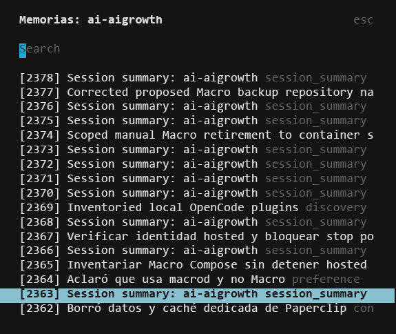
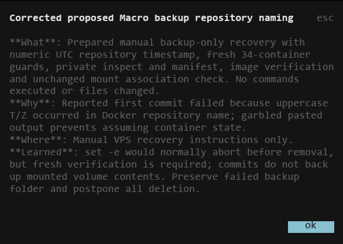

# engram-memory

OpenCode V2 server plugin that automatically sends parent-session prompts and non-error `subagent` tool results to a local Engram HTTP server. **Enable only if you consent to storing that content.**

## Screenshots





## Install

Requires OpenCode V2 (official plugin API 2.0.26), Node.js 22+ for setup/tests, and a separately managed Engram server exposing `/sessions`, `/prompts`, and `/observations/passive` on loopback port 7437 (override with `ENGRAM_PORT`). This plugin neither installs nor starts Engram.

```sh
git clone https://github.com/Thiago-P05/engram-memory.git
cd engram-memory
npm ci --ignore-scripts --omit=optional
npm test
```

Merge into `opencode.json(c)`, preserving other settings and replacing the path:

```json
{
  "$schema": "https://opencode.ai/config.json",
  "plugins": [{ "package": "/absolute/path/engram-memory", "options": { "enabled": true } }]
}
```

No npm release is required. The official `@opencode/plugin` dependency replaces the former local shim; there is no postinstall hook and no deletion or replacement of another package.

## Privacy / opt out

- Set `options.enabled` to `false`, or set `ENGRAM_CAPTURE_DISABLED=1` in the server environment before plugin setup, then reload the plugin using OpenCode's normal lifecycle. Opt-out prevents subscriptions, hook registration, HTTP requests and session metadata capture. Removing the plugin entry also disables capture.
- Captures session ID, project name and working directory; prompts whose redacted text exceeds 10 characters are truncated to 2,000 characters. `subagent` output whose status is not `error` and whose redacted text exceeds 50 characters is **not truncated**. This status check also accepts a missing status; it is not proof of success. Other tools increment an in-memory count, not stored result content.
- Child sessions observed through `session.created` are skipped. A child already running before subscription may not be known; this is not an isolation/security boundary.
- `<private>...</private>` content is replaced with `[REDACTED]` (malformed/nested tags have tests). This is **not a general secret detector**: unmarked credentials, personal data and secrets can be stored. Redaction affects this plugin's copy, not OpenCode's original history or other plugins.
- Uses unauthenticated HTTP to `127.0.0.1`; HTTP failures/timeouts are ignored. Do not treat capture as guaranteed delivery. Protect the local service and its database.
- No retention, deletion or encryption policy is implemented here. Engram controls storage and retention; disabling capture or deleting an OpenCode session does **not** erase prior Engram records. Review and delete retained data using your Engram administration tools.

## Checks

`npm test` uses fake contexts/events and mocked HTTP. No real Engram server or credentials are needed. Official package import/setup is tested; live OpenCode integration remains a separate manual check.

MIT — [LICENSE](LICENSE). [Repository](https://github.com/Thiago-P05/engram-memory) · [V2 plugin API](https://opencode.ai/v2/docs/build/plugins).
